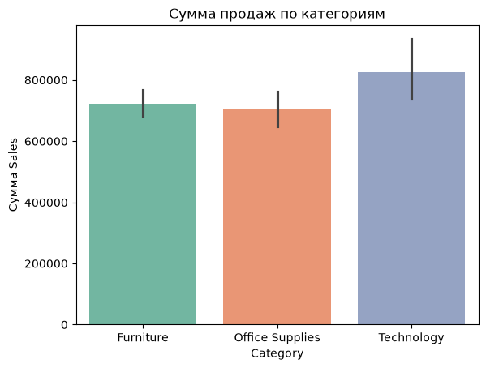
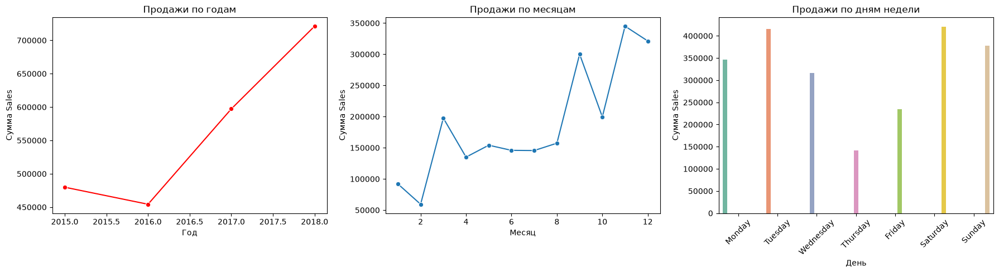
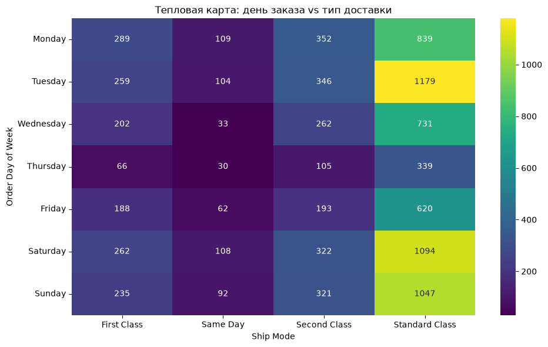

# Аналитика розничной сети Superstore

Разведочный анализ данных (EDA) и проверка статистических гипотез на основе исторических данных о продажах розничной сети Superstore за 2015–2018 годы.

## О репозитории

В репозитории представлен проект по анализу данных на Python. Основная цель — выявить самые прибыльные категории, регионы и сегменты клиентов, а также понять, как логистика и сезонность влияют на продажи. Проект выполнен в Jupyter Notebook.

## Анализ продаж Superstore

### Задача

Руководство розничной сети хочет понять, какие категории товаров и регионы приносят основную выручку, а также найти проблемные зоны в логистике. Результаты должны помочь в корректировке маркетинговой и логистической стратегии.

### Исходные данные

Датасет Superstore Sales Dataset содержит 9800 записей о заказах и 18 переменных: даты заказа и доставки, способ доставки, категория и подкатегория товара, регион, сегмент клиента и сумма продажи. Данные охватывают период с 2015 по 2018 год. Файл лежит в `data/raw/superstore.csv`.

### Методология

1. **Очистка данных:** обработка пропусков, конвертация типов данных (даты, числовые значения), создание новых признаков (год, месяц, день недели, время доставки).
2. **Разведочный анализ (EDA):** описательная статистика, поиск выбросов (метод IQR), анализ распределений и корреляций.
3. **Визуализация:** построение графиков распределения продаж, динамики по времени, сравнение категорий и регионов с помощью Matplotlib и Seaborn.
4. **Проверка гипотез:** использование t-теста, ANOVA и хи-квадрата (χ²) для проверки статистической значимости различий между группами.

### Результаты

1. **Лидер по выручке — Technology.** Категория Technology приносит больше всего денег (825 856) и имеет самый высокий средний чек (456). Это подтверждено t-тестом (p < 0.001).
2. **Регион West — главный драйвер продаж.** Он лидирует по выручке (710 000), в то время как South является аутсайдером (390 000).
3. **Логистика зависит от дня недели.** В понедельник наблюдается пик срочных доставок (First Class), а в четверг — общий спад заказов. Тип доставки также статистически значимо связан с регионом.
4. **Сезонность.** Наблюдается визуальный рост продаж в сентябре–декабре, однако статистически (χ²-тест) связь между категорией и месяцем не подтвердилась.







### Стек

Python 3.x, pandas, numpy, matplotlib, seaborn, scipy, jupyter.

## Структура проекта

* `notebooks/` — Jupyter-ноутбуки с этапами анализа (очистка, EDA, гипотезы).
* `reports/figures/` — сохраненные графики.
* `data/` — исходные данные.
* `README.md` — описание проекта.

## Запуск

1. Установите зависимости:
   ```bash
   pip install -r requirements.txt
2. Запустите Jupyter Notebook:
    ```bash
    jupyter notebook
3. Откройте ноутбуки в папке notebooks/ по порядку (от 01_data_cleaning.ipynb до 04_final_insights.ipynb).